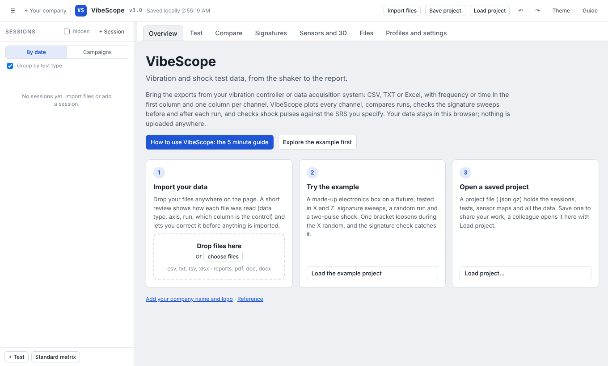
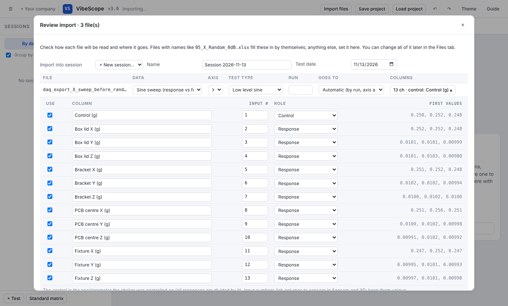
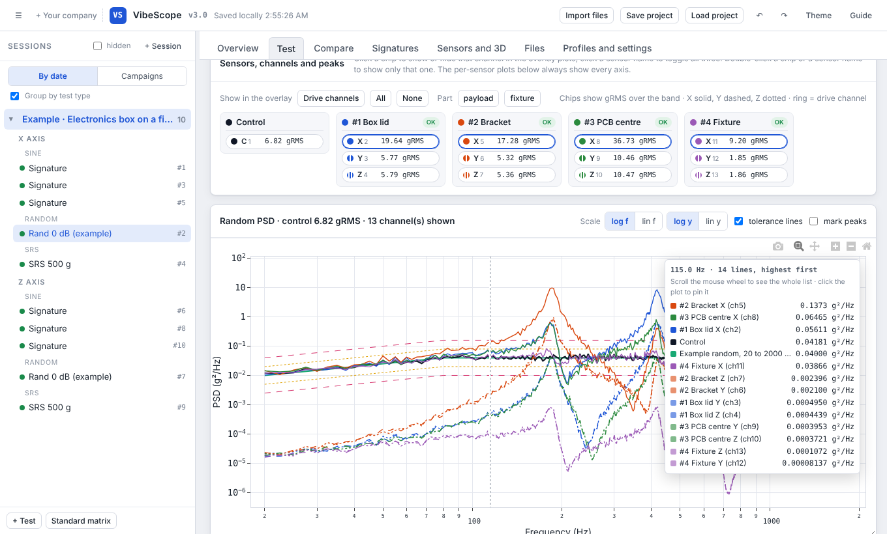
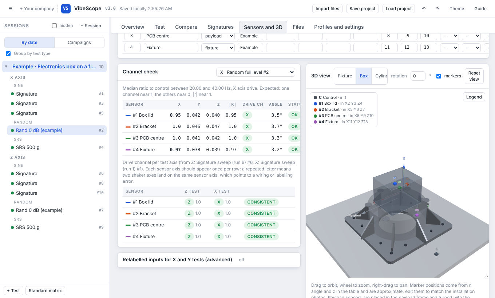
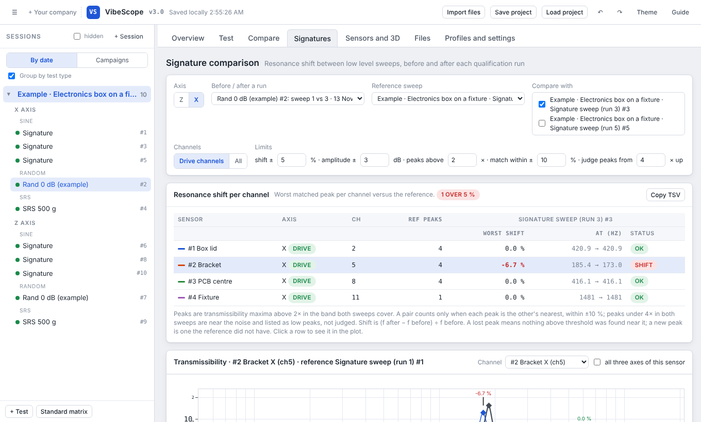
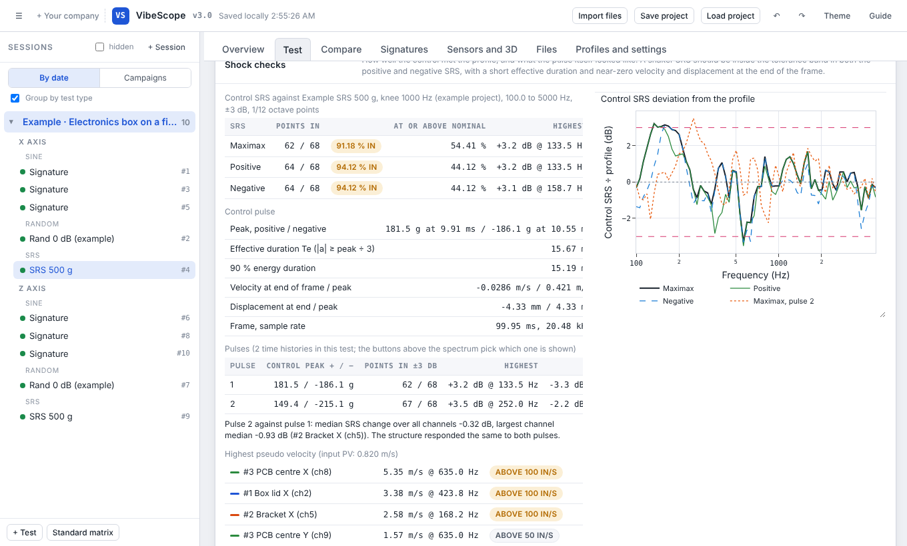
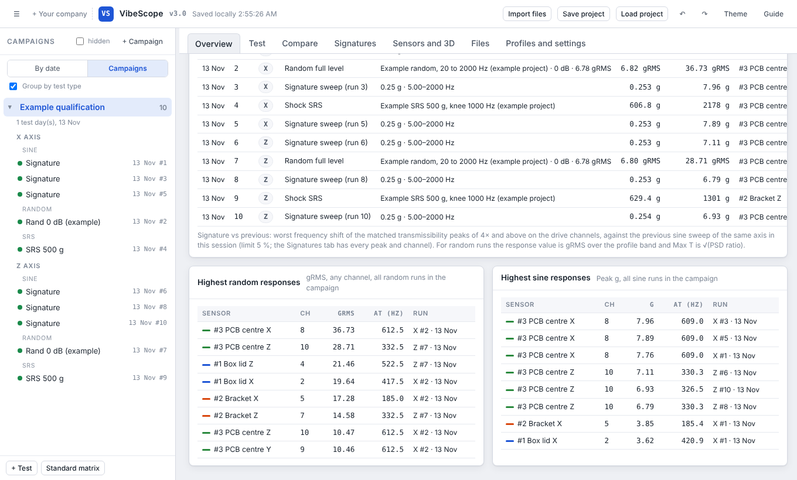

# VibeScope

**Vibration and shock test data, from the shaker to the report.**

VibeScope is a free viewer for environmental test data. Drop in the exports from your vibration controller or data acquisition system and you get every channel plotted, runs compared, signature sweeps checked before and after each run, and shock pulses checked against your SRS. It is one HTML file that runs in your browser. Nothing is installed and nothing is uploaded: your data stays on your computer.

**[Open VibeScope in your browser](https://rohanbaba.github.io/vibescope/)**, or download [`index.html`](index.html) and open it.



---

## What it does

| | |
|---|---|
| **Reads your files as they are** | CSV, TXT (comma, tab or semicolon) and Excel. Frequency or time in the first column, one column per channel. Metadata lines above the header are skipped, units are picked up from the header. Exports from Econ vibration controllers are recognised directly. |
| **Sine, random and shock** | Sine sweeps (response vs frequency), random PSDs (g²/Hz) and RMS histories, shock time histories (turned into an SRS for you) and SRS spectra. Test reports (pdf, doc, docx) attach to their run. |
| **Every channel at a glance** | Channel chips with gRMS or peak per sensor, transmissibility, one plot per sensor, and a hover readout that lists every channel at the cursor, sorted, even with 50 channels. |
| **Signature checks** | Before and after sweeps are paired with their run automatically. Resonances are matched channel by channel and every frequency shift is checked against your limit. |
| **Shock checks** | Control SRS against the profile (maximax, positive, negative), share of points in tolerance, effective duration, velocity and displacement, SRS amplification per location, pseudo velocity, and pulse-to-pulse comparison. |
| **Sensors and 3D** | Map input numbers to sensors, see them on a 3D fixture, and let the channel check find which axis of each sensor carries the shaker motion and which channels cannot be real. |
| **Campaigns** | Collect only the runs that count, from any number of test days, and get one overview of the campaign. |
| **Yours** | Add your company name and logo. Save the whole project as one file and share it; a colleague opens it in the same page. |

---

## How to use it

The same guide, with these pictures, is built into the app: press **Guide** at the top right.

### 1. Bring your data

Drop files anywhere on the page, or press **Import files**. Not sure where to start? Press **Load the example project**: a made-up electronics box tested in X and Z, in which one bracket loosens during the random run. The raw files of that example are in [`examples/`](examples) if you want to try the import yourself.

### 2. Check the import

When a file is not recognised from its name and layout, a short review opens. For each file you set the data type, axis, test type, run number and where it goes (a new test, an existing one, or automatically by run). Open **Columns** to choose the control channel (the accelerometer the shaker was controlled on), the input number of each column, and the columns to leave out. Everything can be changed later in the **Files** tab.



### 3. Look at a test

The left panel lists the test days (sessions) and their tests by axis, optionally under Sine, Random and SRS headings. Click a test to open it. Click the chips to show or hide channels, double-click to show only one. Hover the plot for exact values; with many channels the values go into a list beside the plot that you scroll with the mouse wheel, and a click pins it so you can move into it.



### 4. Map the sensors

In **Sensors and 3D**, name each accelerometer, say where it sits (payload, fixture, table) and which input numbers carry its X, Y and Z. The channel check uses the low-frequency part of each run, where everything moves with the table, to tell which channel of each sensor points along the shaker and to flag channels that are noise or a loose cable.



### 5. Signatures before and after

A low level sine sweep before and after each qualification run should show the same resonances. **Signatures** matches the peaks of two sweeps for every channel and checks the frequency shift against the limit (5 % by default). Pick a run in *Before / after a run*, or press *Compare before vs after* on any test page. In the example, the bracket mode drops by 6.7 % after the X random and is flagged.



### 6. Shock and the SRS

For a shock test the SRS of every channel is computed from the time history (Q = 10). **Shock checks** shows how well the control met the profile, the control pulse itself, the SRS amplification at each location and the pseudo velocity. Several pulses of the same run stay together and are compared.



### 7. Campaigns and Compare

Test days have check runs, repeats and false starts. Switch the left panel to **Campaigns** and collect only the runs that count (right-click tests in the *By date* view to add them). The campaign overview lists them by axis and date with their headline numbers. **Compare** overlays the same channel across runs, levels or axes.



### 8. Save and share

Everything is kept in your browser automatically. **Save project** writes one file (`.json.gz`) with all sessions, tests, sensor maps and data. Send it to a colleague; they open VibeScope and use **Load project**.

---

## Your data stays yours

VibeScope runs entirely in the browser. Files you import are read locally and stored in the browser's own storage (IndexedDB). No server, no account, no upload. The page loads three open-source libraries from cdnjs (Plotly, SheetJS, three.js); after that it needs no network.

---

## Build from source

The app is plain HTML, CSS and JavaScript in `src/`. `build.py` joins it into one file:

```
python3 build.py              # writes index.html
python3 build.py --site site/my_site.js --out my_vibescope.html
```

| Path | What it is |
|---|---|
| `src/01_head.html`, `src/02_body.html` | Styles and page layout |
| `src/03_core.js` | Data model, file reading, profiles |
| `src/04_metrics.js` | Metrics, SRS, plotting helpers |
| `src/05_ui.js`, `src/05b_onboarding.js` | Left panel, import review, campaigns, first screen, guide, example project |
| `src/06_views.js`, `src/06b_signatures.js` | Test, Compare, Files, Settings, Signatures |
| `src/07_three.js` | Sensors tab and 3D view |
| `src/08_init.js` | Start-up, save and load, migrations |
| `site/default.js` | Site settings: default brand, profile library, the fixture drawn in 3D |
| `docs/guide_images.js` | Pictures for the built-in guide |
| `examples/` | Raw CSV files of the example project |

To make your own edition (your company's profiles, logo, fixture), copy `site/default.js`, edit it, and build with `--site`.

---

## Contributing

Issues and pull requests are welcome: file layouts that are not read correctly (attach a sample with made-up numbers), checks you would like to see, or fixes. Please never attach real test data that is not yours to share.

## License

[MIT](LICENSE). Uses [Plotly.js](https://github.com/plotly/plotly.js) (MIT), [SheetJS Community Edition](https://github.com/SheetJS/sheetjs) (Apache 2.0) and [three.js](https://github.com/mrdoob/three.js) (MIT).
